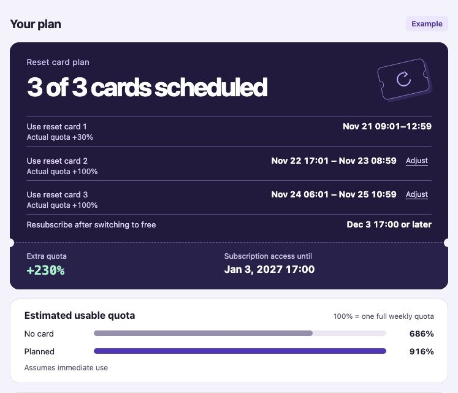

<div align="center">

# Resetwise · Codex Reset Card & Quota Planner

Find when to use your Codex reset cards and compare how much quota you can use if you renew, change plans, or let your subscription expire.

[**Open the calculator**](https://codex-resetwise.vercel.app/) · [Reset card guide](https://codex-resetwise.vercel.app/codex-reset-cards.html) · [简体中文](README.zh-CN.md)

</div>

<p align="center">
  
</p>

## What you can plan

- **Use multiple reset cards.** See when to use each card and how much usable quota it adds.
- **Compare and adjust.** Move a card or renewal to another time window with the same projected quota.
- **Fit your limits and schedule.** Account for weekly quotas, optional 5-hour windows, and up to three announced resets. Use Healthy mode to plan around your waking hours.

## Codex skill

The skill sends planning inputs to the hosted Resetwise planner by default. You can run it directly in Codex without starting a local server.

1. Sign in to Codex and make sure Node.js is available in its environment.
2. Paste the GitHub link to the [skill directory](codex-plugin/skills/plan-codex-quota) into Codex and ask it to install the skill with `$skill-installer`.
3. Invoke `$plan-codex-quota` in Codex.

The skill reads your remaining quota and reset cards. Provide your subscription expiry and any missing card details when prompted. It calculates with a 0-day iOS grace period and returns a written plan and a link that prefills the web form.

<details>
<summary>Local development, tests, and Vercel deployment</summary>

Run the development server with `node server.mjs` and open [the local site](http://127.0.0.1:3000/). To test the skill against this server, set `RESETWISE_BASE_URL=http://127.0.0.1:3000` in the skill's environment.

```sh
node --test
```

The website and tests run with Node.js alone and have been verified on Node.js 24.

Vercel uses `vercel.json` to serve `public/` and runs the planner through `api/plan.mjs`. When deploying multiple instances, set the same randomly generated `RESETWISE_PLAN_SECRET` on each server to sign and verify plan tokens.

</details>

The code is available under the [MIT License](LICENSE).
