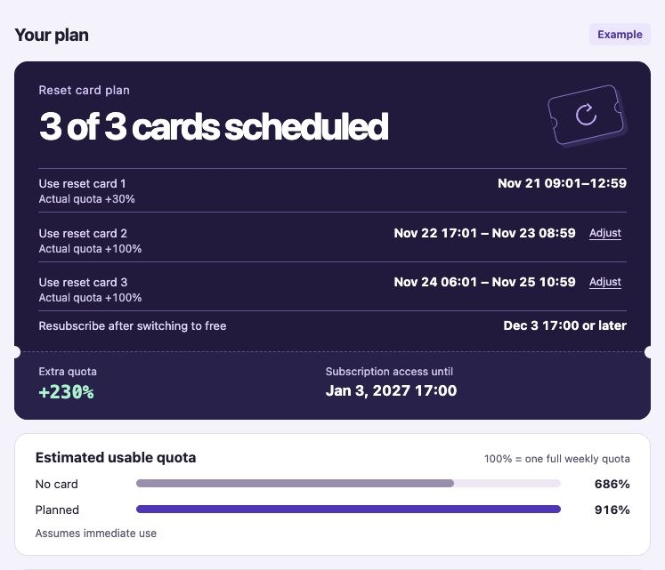

<div align="center">

# Resetwise · Codex 重置卡与额度规划器

计算 Codex 重置卡什么时候用，并比较续订、换档或到期不续订时的预计可用额度。

[**打开计算器**](https://codex-resetwise.vercel.app/) · [重置卡使用指南](https://codex-resetwise.vercel.app/zh/codex-reset-cards.html) · [English](README.md)

</div>

<p align="center">
  
</p>

## 可以规划什么

- **安排多张重置卡。** 查看每张卡的使用时段和真实额度。
- **比较和调整方案。** 将用卡或续订移到预计可用额度相同的时段。
- **纳入额度规则和作息。** 可设置周额度、5 小时窗口和最多 3 条自动重置公告。健康模式按可用时段规划。

## 在 Codex 中使用 Skill

Skill 默认把规划输入发到 Resetwise 线上服务计算。安装后可直接在 Codex 中使用，无需启动本地服务。

1. 登录 Codex，并确认 Codex 环境可以运行 Node.js。
2. 把 [Skill 目录](codex-plugin/skills/plan-codex-quota)的 GitHub 链接贴给 Codex，请它用 `$skill-installer` 安装。
3. 在 Codex 中运行 `$plan-codex-quota`。

Skill 会读取剩余额度和重置卡。按提示补充订阅到期时间及缺失的卡片信息。Skill 按 0 天 iOS 宽限期计算，返回文字方案和网页预填链接。

<details>
<summary>本地开发、测试与 Vercel 部署</summary>

运行 `node server.mjs` 启动开发服务，再打开[本地网页](http://127.0.0.1:3000/)。测试 Skill 时，可在它的运行环境中设置 `RESETWISE_BASE_URL=http://127.0.0.1:3000` 来连接本地服务。

```sh
node --test
```

网页和测试可直接用 Node.js 运行，已在 Node.js 24 上验证。

Vercel 使用 `vercel.json` 发布 `public/`，并通过 `api/plan.mjs` 运行规划器。多实例部署时，在服务端为各实例设置同一个随机的 `RESETWISE_PLAN_SECRET`，用于签名和验证方案令牌。

</details>

代码采用 [MIT 许可证](LICENSE)。
